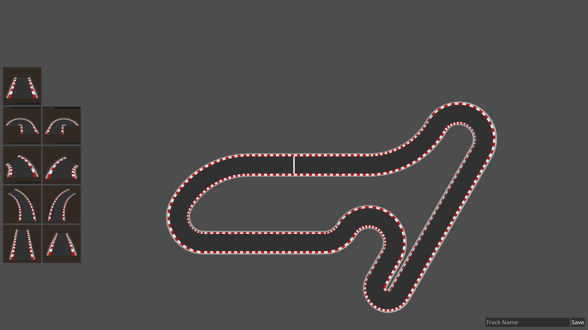
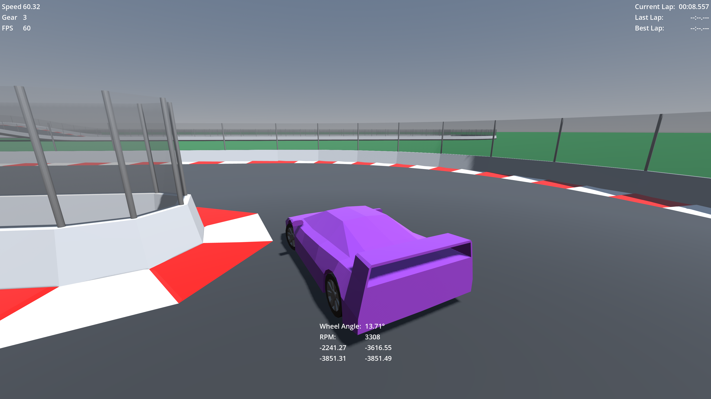
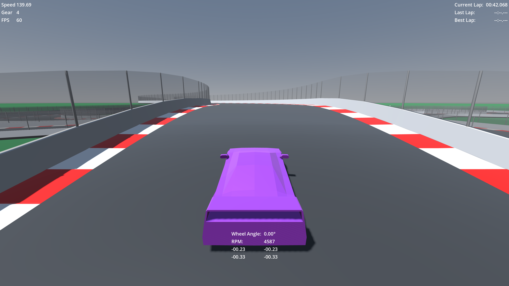
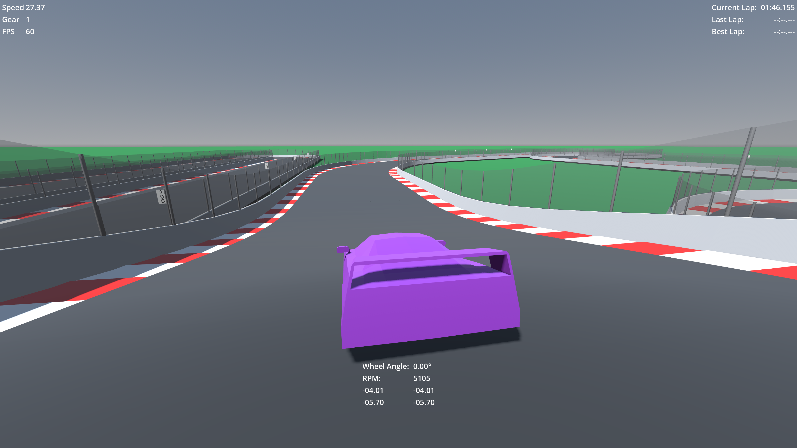

# My Racing Game

My Racing Game is a racing game featuring a simple, physics-based car model and a track editor.

## Project goals

This project is primarily a playground for learning about game development. Its goals are to:

- Explore and learn about game development in general.
- Have fun implementing and playing around with 3D car physics.
- Learn 3D modeling in Blender.

## Features

### Track editor

The game features a track editor that lets you easily create your own racing circuits by placing roads from a varied selection.

### Racing

In racing mode, you can drive around the tracks you created in the editor.
The car can be controlled using either a gamepad or the keyboard, and features an automatic or manual gearbox.

## Technology

- Godot
- Blender

## Current status

As of now, the game is nothing more than a playable prototype. Future works include reworking the car physics for improved handling and feel, implementing some sort of progress system, like unlockable vehicle upgrades, and implementing a local multiplayer mode.
